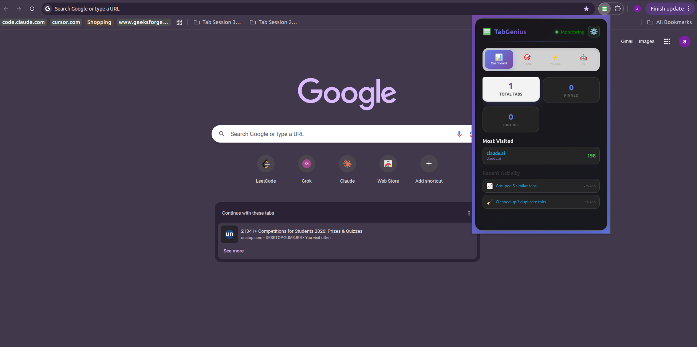
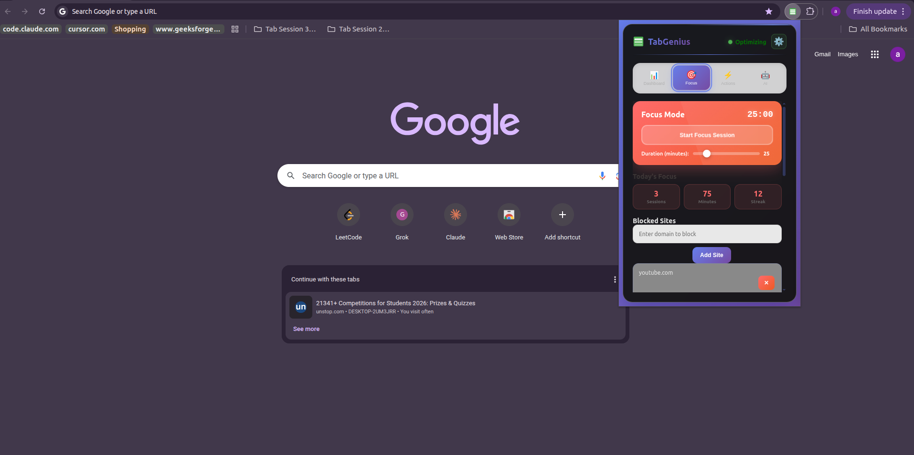

# TabGenius — Research Workspaces

A Chrome Manifest V3 extension for keeping research papers, repositories, documentation, and notes together. Save a project's tabs, resume its sources in a new window, and track focused work against a specific task.

## Install locally

1. Download or clone this repository.
2. Open `chrome://extensions` in Chrome.
3. Enable **Developer mode**, choose **Load unpacked**, and select this folder (the one containing `manifest.json`).
4. Pin TabGenius to the toolbar and open it.

After updating these files, click **Reload** on the TabGenius card at `chrome://extensions`, then reopen the popup. There is no build step or API key.

## Research workflow

1. In **Research**, create a project such as “VLA literature review.”
2. Choose tabs from the current window and click **Add selected tabs**. Duplicate URLs are merged; notes for existing sources are retained.
3. Write research questions and next steps, then click **Save notes**. Each source also has its own notes and editable source type under **Notes & actions**. Click **Save source notes** to persist those edits.
4. Search saved sources by title, URL, or notes, or filter by Paper, Repository, Documentation, or Other. Source types are inferred from URLs and can be corrected manually.
5. In **Focus**, choose the project, enter a task, and start the timer. Project and task stay attached to the running session. Completed and interrupted sessions appear in project history; today's totals use this device's local date.
6. Click **Restore in new window** to reopen saved URLs, pins, and groups without closing your current window. Restored windows are excluded from automatic grouping for the current browser session so their saved groups are preserved.
7. Use **Export Markdown** to download the saved project notes and source links. Save pending project and source edits before exporting.

**Replace saved tabs** replaces the collection with the selected current tabs after confirmation. Notes for retained URLs survive. Removing a source or deleting a project leaves open browser tabs untouched. Deleting a project retains its historical focus records in local storage.

## Screenshots

<p align="center">
  
  &nbsp;&nbsp;
  
</p>
<p align="center">
  <em>Dashboard View &nbsp;&nbsp;&nbsp;&nbsp;&nbsp;&nbsp;&nbsp;&nbsp;&nbsp;&nbsp;&nbsp;&nbsp;&nbsp;&nbsp;&nbsp;&nbsp;&nbsp;&nbsp; Focus Mode</em>
</p>

## What is saved

Projects store titles, HTTP/HTTPS URLs, notes, pins, and tab-group metadata in `chrome.storage.local`. Private tabs, browser-internal pages, and URLs containing embedded credentials are excluded. This feature does not upload project data or fetch page content.

Restoration opens saved URLs; it does not capture scroll positions, login state, unsaved forms, or page contents. Repeated restores create additional windows. If restoration is interrupted, already-opened tabs stay open and the saved project remains available.

There are limits of 100 projects, 500 sources per project, 10,000 characters per project note, 4,000 characters per source note, and the most recent 1,000 focus sessions. Chrome's extension storage quota also applies; failed writes surface an error rather than silently discarding the previous collection. Export valuable notes regularly: local extension storage is removed when the extension is uninstalled.

Existing grouping, pinning, cleanup, bookmarks, and focus blocking remain available under **Overview**, **Actions**, and **Focus**. **Insights** provides local statistics and rule-based suggestions; it does not use an AI model.

## Development and checks

No dependencies are required. Run the workspace and background integration checks with Node.js 20 or later:

```bash
node tests/research.test.cjs
```

The checks cover persistence and concurrent saves, source-note retention, filtering of unsupported/private URLs, Markdown export, content-script access restrictions, window/group restoration, and project focus accounting. They use mocked Chrome APIs. A live extension check is still useful after loading the unpacked extension.

Main files:

| File | Purpose |
|---|---|
| `research-core.js` | Workspace storage, serialized writes, classification, Markdown export |
| `research-background.js` | Validated project requests and tab restoration |
| `research.js`, `research.css` | Research and project-focus UI |
| `popup.html`, `popup.js`, `popup.css` | Shared popup, existing actions, focus controls |
| `background.js` | Chrome events, alarms, focus state and session history |
| `blocked.html`, `blocked.js` | Focus blocking page with packaged scripts |
| `manifest.json` | Extension metadata, permissions and entry points |

Inspect the popup using its context menu, or inspect the service worker from `chrome://extensions`, to troubleshoot errors.
